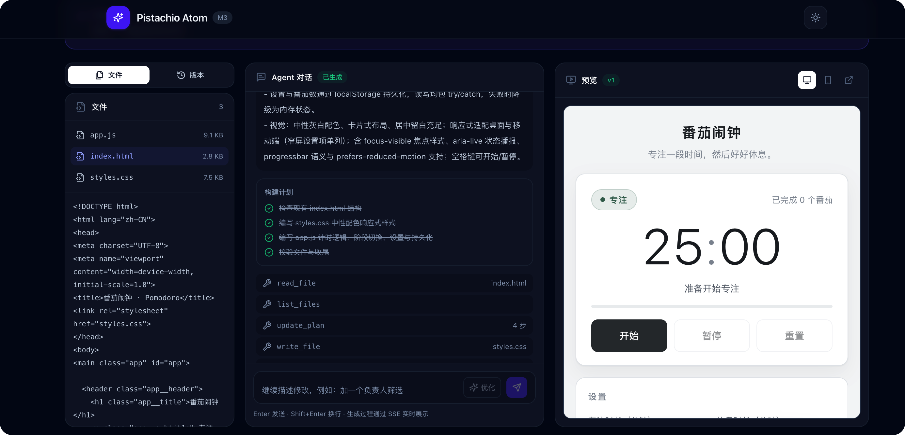
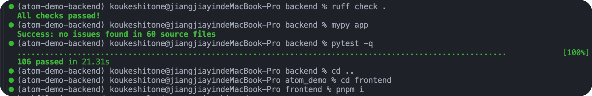
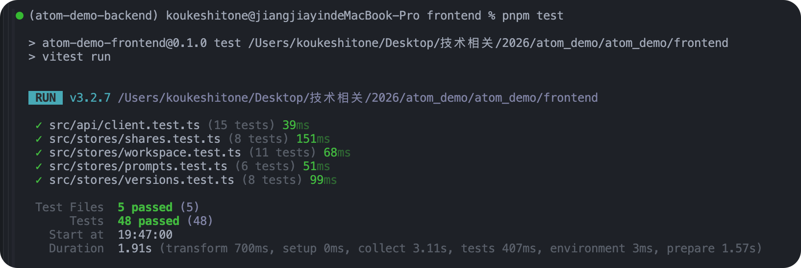

# Pistachio Atom

一个智能体建站 Demo：用一句话描述需求，由 Agent 逐个写入文件并实时预览生成的应用。

**在线体验：** [https://atom.pistachio.asia/](https://atom.pistachio.asia/)

> 当前进度：**M3 版本、导出与只读分享**。已可创建项目、发起生成、查看 Agent 计划/工具/文件事件流，并在隔离预览域运行生成结果；支持版本列表、版本 diff、回滚为新版本、ZIP 导出与带有效期的只读分享链接。未配置 `LLM_API_KEY` 时自动进入演示模式（界面与事件会明确标注），不伪造真实模型输出。在线代码编辑按计划推迟，不计入本阶段范围。

## Agent 对话效果



## 核心文档

- [需求文档](docs/01-需求文档.md)：产品定位、用户场景、功能需求与验收标准
- [技术方案](docs/02-技术方案.md)：架构、选型取舍、API/SSE 契约、安全与部署、扩展路线
- [功能清单](docs/03-功能清单.md)：按模块列出的功能状态（已完成 / 部分完成 / 未实现）


## 质量检查通过率

后端（`ruff check` / `mypy` / `pytest`）：



前端（`lint` / `typecheck` / `test` / `build`）：



## 技术栈

- 前端：Vue 3 + TypeScript（strict）+ Vite + Pinia + Vue Router + Tailwind CSS 4
- 后端：Python 3.13 + FastAPI + Pydantic v2 + SQLAlchemy 2.0 async + asyncmy + Alembic
- 数据库：MySQL 8.0（唯一事实源；不使用 Redis）
- LLM：DeepSeek `deepseek-chat`（OpenAI 兼容，流式 + tool calling）
- 部署：Docker Compose + Caddy，双域名 `app.` / `preview.`，轻量服务器

## 目录

```
backend/    FastAPI 应用、Agent、Alembic 迁移、测试
frontend/   Vue 3 SPA
deploy/     Caddyfile、nginx.conf、deploy.sh
prepare/    对外文档：需求文档、技术方案、功能清单
```


## 本地启动

### 1. 启动 MySQL

```bash
cp .env.example .env          # 按需修改密码
docker compose up -d mysql      # 宿主机端口 3307，避免占用本机已有 MySQL
```

### 2. 启动后端

```bash
cd backend
cp .env.example .env          # DATABASE_URL 默认指向 127.0.0.1:3307
uv sync
uv run alembic upgrade head
uv run uvicorn app.main:app --reload --port 8000
```

验证：

```bash
curl http://127.0.0.1:8000/healthz
curl http://127.0.0.1:8000/api/v1/meta
```

### 3. 启动前端

```bash
cd frontend
pnpm install
pnpm dev                      # http://localhost:5173，/api 与 /healthz 代理到 8000
```

## 一键容器启动

```bash
cp .env.example .env          # 填域名、MySQL 密码、DeepSeek Key
docker compose build
docker compose up -d
```

- `app.<domain>`：前端页面，`/api/*` 与 `/healthz` 转发到 API
- `preview.<domain>`：仅 `/preview/*` 与 `/share-preview/*` 提供生成应用的隔离预览
- MySQL 只绑定本机，不暴露公网

服务器更新：`./deploy/deploy.sh`。脚本会重建镜像、启动服务并 reload Caddy；Caddy 以 `--watch` 运行，且挂载整个 `deploy/` 目录（而非单个 `Caddyfile`），`git pull` 替换文件后新配置能被容器看到并自动生效。


## 一键部署

```bash
cd backend

sh deploy/deploy.sh
或
bash deploy/deploy.sh
```


## 

## 里程碑

| 阶段 | 内容 | 状态 |
|---|---|---|
| M0 | 工程骨架、健康检查、数据模型、Docker/Caddy 部署 | 完成 |
| M1 | 匿名 guest、项目 CRUD、工作台布局、版本模型 | 完成 |
| M2 | DeepSeek Agent 循环、VFS 工具、SSE 实时事件、隔离预览 | 完成 |
| M3 | 版本列表 / diff / 回滚、ZIP 导出、只读分享（在线编辑推迟） | 完成 |

## 安全边界（摘要）

- 生成代码只在预览域 iframe 中运行，服务端从不执行生成代码。
- 项目文件存 MySQL，所有写入走 VFS 工具与路径/大小白名单校验。
- Guest token 仅存 SHA-256 哈希，通过 `Authorization: Bearer` 传递，不使用 Cookie。
- 版本快照不可变；回滚生成新版本。
