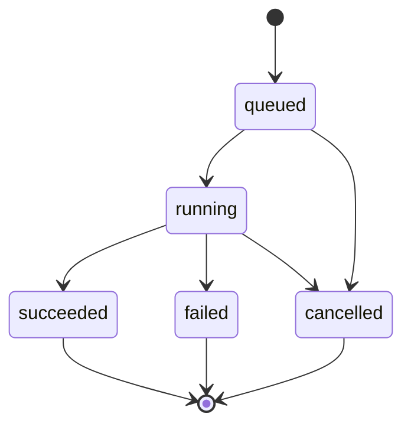
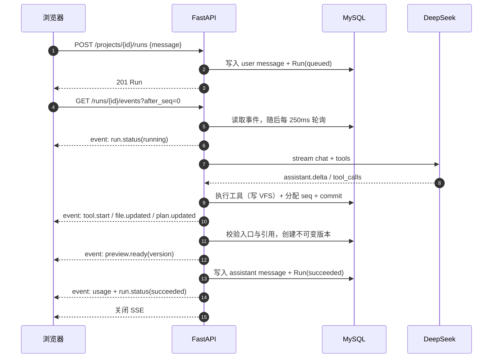
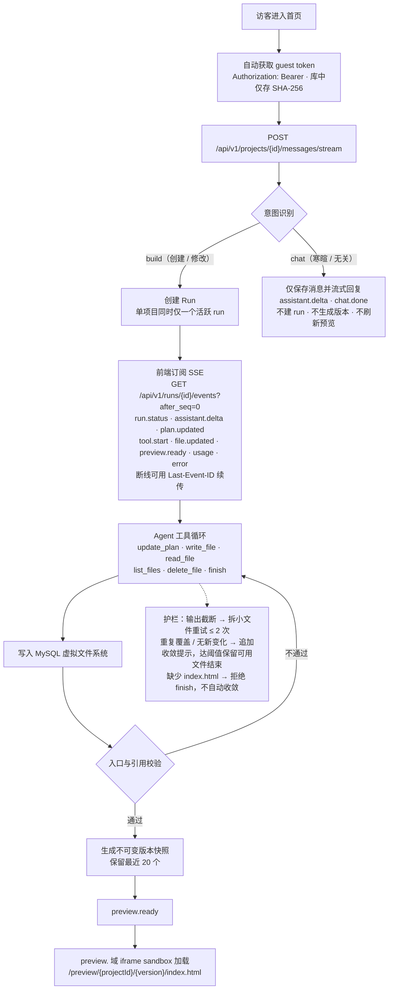
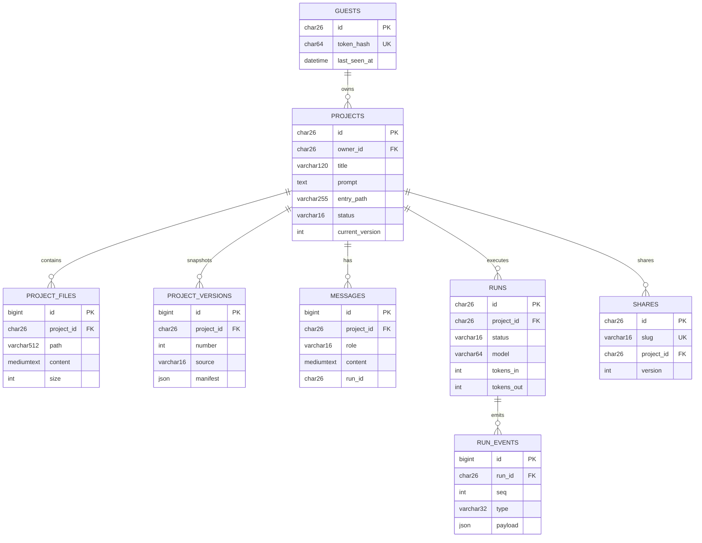

# Pistachio Atom 技术方案

| 项目 | 内容 |
|---|---|
| 文档版本 | v1.0 |
| 日期 | 2026-11-08 |
| 对应阶段 | M0–M3（在线编辑推迟） |
| 关联文档 | `01-需求文档.md`、`03-功能清单.md`、仓库 `README.md`、`CLAUDE.md` |

---

## 1. 架构总览

```
                          ┌──────────────────────────────┐
                          │          浏览器               │
                          │  Vue 3 SPA（主站域）          │
                          └──────────────┬───────────────┘
                                         │ HTTPS
                          ┌──────────────▼───────────────┐
                          │            Caddy             │
                          │  app.──► web(nginx SPA)      │
                          │       └► api /api/* /healthz │
                          │  preview.──► api /preview/*  │
                          │            /share-preview/*  │
                          └───────┬──────────────┬───────┘
                                  │              │
                     ┌────────────▼───┐   ┌──────▼─────────────────┐
                     │ nginx 静态资源 │   │ FastAPI API            │
                     │ Vue 构建产物   │   │ routes → services → db │
                     └────────────────┘   │        └► agent        │
                                          │             └► LLM GW  │
                                          └──────┬─────────────────┘
                                                 │ asyncmy
                                          ┌──────▼──────┐
                                          │  MySQL 8    │
                                          │ 唯一事实源  │
                                          └─────────────┘
```

- **主站域**：页面、业务 API、SSE。
- **预览域**：只提供生成应用的静态文件（`/preview`）与分享预览（`/share-preview`），不暴露业务 API。
- **MySQL**：项目、文件、版本、消息、run、事件、分享全部落库；无 Redis、消息队列、对象存储。
- **LLM**：仅在 API 进程内经 `LLMGateway` 调用 DeepSeek；前端不持有 Key，不直连模型。


### 1.1 Run 状态机



- 单项目同时只允许一个 `queued` / `running` run，重复发起返回 `409`。
- 取消不提交版本；失败通过 `error` + `run.status(failed)` 通知前端。


### 1.2 一次生成的时序示意




### 1.3 生成流程



项目标题在创建时由后端根据描述生成（6–20 字，保留品牌/行业关键词），不再直接截取描述原文；演示模式、标题模型失败或超时（8s）时回退到模板分类标题（团队任务看板 / 习惯打卡 / 个人作品集 / 创意原型），不影响项目创建。显式传入 `title` 时不做模型调用。

---


## 2. 技术选型与关键取舍

### 2.1 选型表

| 层 | 选型 | 理由 | 放弃的方案 |
|---|---|---|---|
| 前端 | Vue 3 + TS strict + Vite + Pinia + Vue Router + Tailwind 4 | 组合成熟、构建快、类型安全；Tailwind 适合快速搭建一致的暗色/响应式 UI | React/Next（SSR 与生成代码安全边界无关，反而增加复杂度） |
| 后端 | Python 3.13 + FastAPI + Pydantic v2 | 异步 IO、SSE 友好、OpenAPI 原生；Pydantic 适合 LLM 工具参数校验 | Django（偏重，异步生态弱）；Node（与前端同构收益有限） |
| ORM | SQLAlchemy 2.0 async + asyncmy | 类型化模型、显式事务边界 | 同步驱动（阻塞事件循环）；SQLModel（抽象不足） |
| 数据库 | MySQL 8 | 单一事实源；JSON manifest、MEDIUMTEXT 满足文件存储 | SQLite（并发/部署不匹配）；Mongo（契约弱）；文件系统（多实例与事务一致性差） |
| LLM | DeepSeek `deepseek-chat`（OpenAI 兼容，流式 + tool calling） | 工具调用稳定、成本可控、国内可访问 | 自建推理、LangChain（引入不必要抽象） |
| 流式 | SSE + 事件落库 | 单向、可回放、经代理友好；断线可续传 | WebSocket（双向无用、代理与扩容复杂）；轮询接口（延迟高） |
| 部署 | Docker Compose + Caddy | 双域名与 TLS 自动签发；部署面小 | K8s / 云厂商编排（超出 MVP 规模） |
| 包管理 | pnpm / uv | 锁文件稳定、安装快 | npm / pip（速度与可重现性差） |

### 2.2 关键取舍

| 决策 | 取舍 | 原因 |
|---|---|---|
| 生成文件存 MySQL | 牺牲大文件与 Git 式版本存储效率，换取事务一致与单事实源 | MVP 文件上限 32KB/256KB，规模可控；避免文件系统与数据库双写不一致 |
| 版本用全量 JSON 快照 | 存储冗余，换取实现简单与不可变语义 | 版本数上限 20；diff 可随时由快照计算，无需增量链 |
| 单项目同时一个 run | 牺牲并发吞吐，换取状态简单 | 避免同一项目文件并发写冲突；前端输入与预览状态也无需合并 |
| 全局并发 2 个 run | 牺牲吞吐，保护模型与 DB | 演示服务器资源有限；配合队列语义（超出由前端禁用发送） |
| SSE 事件先落库再推送 | 多一次写库，换取可回放与断线续传 | 生成过程必须可恢复；事件也构成审计轨迹 |
| SSE 采用 0.25s 轮询数据库 | 延迟略高（≤250ms），换取无消息总线 | 不引入 Redis Pub/Sub；生成事件量小，轮询成本可接受；每次轮询后 commit 避免 MySQL REPEATABLE READ 读旧快照 |
| 匿名 guest | 牺牲账号与跨设备能力，换取零门槛 | 交付要求「无需注册」；服务端只存 token 哈希 |
| 生成代码绝不执行 | 无法做服务端渲染/校验运行时行为 | 安全红线；预览用独立域 iframe + sandbox |
| 演示模式 | 无 Key 时能力受限 | 保证演示可运行，同时明确标注，不伪造模型输出 |
| 在线编辑推迟 | 牺牲直接编辑体验 | 编辑器、保存语义、冲突处理与版本策略成本高；对话迭代已覆盖主路径 |

---

## 3. 数据模型

| 表 | 关键字段 | 说明 |
|---|---|---|
| `guests` | `id`(ULID), `token_hash`(SHA-256), `last_seen_at` | 匿名身份；token 明文不落库 |
| `projects` | `id`, `owner_id`, `title`, `prompt`, `entry_path`, `status`, `current_version` | 项目主记录；索引 `(owner_id, updated_at)` |
| `project_files` | `project_id`, `path`, `content`(MEDIUMTEXT), `size` | 当前 VFS；唯一约束 `(project_id, path)` |
| `project_versions` | `project_id`, `number`, `label`, `source`, `manifest`(JSON) | 不可变快照；唯一 `(project_id, number)` |
| `messages` | `project_id`, `role`, `content`, `run_id` | `run_id` 空 = 普通聊天，非空 = 生成上下文；索引 `(project_id, id)` |
| `runs` | `id`, `project_id`, `status`, `model`, `tokens_in/out`, `error_*`, 时间戳 | 一次生成任务 |
| `run_events` | `run_id`, `seq`, `type`, `payload`(JSON) | 事件流；唯一 `(run_id, seq)` |
| `shares` | `id`, `slug`(唯一), `project_id`, `version`, `expires_at`, `revoked` | 只读分享 |

约定：所有表结构经 Alembic 管理；时间以 UTC 存储；项目 ID 使用 ULID；不返回 ORM 模型，统一 Pydantic Schema。


### 3.1 数据库表结构与关系

MySQL 8.0 是唯一事实源，共 8 张表。建表通过 Alembic 迁移（当前为单版本 `3a928c872f97_initial_schema.py`），禁止 `create_all` 或手改已应用迁移。

#### 3.1.1 ER 示意图



等价关系速览：

```text
guests 1 ── N projects
projects 1 ── N project_files
projects 1 ── N project_versions
projects 1 ── N messages
projects 1 ── N runs 1 ── N run_events
projects 1 ── N shares
```

#### 3.1.2 表一览

| 表 | 作用 | 关键约束 |
|---|---|---|
| `guests` | 匿名访客 | `token_hash` 唯一；删除级联项目 |
| `projects` | 项目与当前状态 | `(owner_id, updated_at)` 索引 |
| `project_files` | 当前虚拟文件系统 | `(project_id, path)` 唯一 |
| `project_versions` | 不可变版本快照 | `(project_id, number)` 唯一；仅保留最近 20 个 |
| `messages` | 对话消息 | `(project_id, id)` 索引 |
| `runs` | 每次生成任务 | `(project_id, created_at)` 索引 |
| `run_events` | SSE 事件持久化 | `(run_id, seq)` 唯一，`seq` 单调递增 |
| `shares` | 只读分享 | `slug` 唯一；每项目最多 10 个有效分享 |

#### 3.1.3 字段说明

##### guests

| 字段 | 类型 | 说明 |
|---|---|---|
| `id` | varchar(26) PK | ULID |
| `token_hash` | char(64) UK | guest token 的 SHA-256，不存明文 |
| `last_seen_at` | datetime NULL | 最近访问时间 |
| `created_at` / `updated_at` | datetime | UTC |

##### projects

| 字段 | 类型 | 说明 |
|---|---|---|
| `id` | varchar(26) PK | ULID |
| `owner_id` | varchar(26) FK | → `guests.id`，级联删除 |
| `title` | varchar(120) | 项目标题 |
| `prompt` | text | 初始需求描述 |
| `entry_path` | varchar(255) | 入口文件，默认 `index.html` |
| `status` | varchar(16) | `idle` / `queued` / `running` / `succeeded` / `failed` |
| `current_version` | int NULL | 当前版本号，成功生成后递增 |
| `created_at` / `updated_at` | datetime | UTC |

索引：`ix_projects_owner_updated(owner_id, updated_at)`。

##### project_files

当前 VFS 文件（每项目每路径一行，写入即覆盖）。

| 字段 | 类型 | 说明 |
|---|---|---|
| `id` | bigint PK AI | 自增 |
| `project_id` | varchar(26) FK | → `projects.id`，级联删除 |
| `path` | varchar(512) | 相对路径，白名单校验 |
| `content` | mediumtext | 文件内容，单文件 ≤ 32 KB |
| `size` | int | 字节数 |
| `updated_at` | datetime | UTC |

唯一约束：`uq_project_files_project_path(project_id, path)`。

##### project_versions

成功 run 后生成的不可变快照，回滚只会新增版本，不修改历史。

| 字段 | 类型 | 说明 |
|---|---|---|
| `id` | bigint PK AI | 自增 |
| `project_id` | varchar(26) FK | → `projects.id`，级联删除 |
| `number` | int | 版本号，从 1 递增 |
| `label` | varchar(120) | 展示名 |
| `source` | varchar(16) | 来源：`agent` / `restore` |
| `manifest` | json | `{"entry": "index.html", "files": {"path": "content"}}` |
| `created_at` | datetime | UTC |

唯一约束：`uq_project_versions_project_number(project_id, number)`；超出 20 个的旧版本会被裁剪。

##### messages

| 字段 | 类型 | 说明 |
|---|---|---|
| `id` | bigint PK AI | 自增 |
| `project_id` | varchar(26) FK | → `projects.id`，级联删除 |
| `role` | varchar(16) | `user` / `assistant` |
| `content` | mediumtext | 消息正文 |
| `run_id` | varchar(26) NULL | 关联 run（当前未加外键） |
| `created_at` | datetime | UTC |

索引：`ix_messages_project_id(project_id, id)`。

##### runs

| 字段 | 类型 | 说明 |
|---|---|---|
| `id` | varchar(26) PK | ULID |
| `project_id` | varchar(26) FK | → `projects.id`，级联删除 |
| `user_message_id` | bigint NULL | 触发该 run 的 user message |
| `status` | varchar(16) | `queued` / `running` / `succeeded` / `failed` / `cancelled` |
| `model` | varchar(64) | 默认 `deepseek-chat` |
| `tokens_in` / `tokens_out` | int | usage 统计 |
| `error_code` | varchar(64) NULL | 失败错误码 |
| `error_message` | text NULL | 失败原因（脱敏） |
| `created_at` | datetime | 创建时间 |
| `started_at` / `finished_at` | datetime NULL | 生命周期时间 |

索引：`ix_runs_project_created(project_id, created_at)`。

##### run_events

SSE 事件的持久化来源，先落库分配 `seq` 再推送，因此可回放。

| 字段 | 类型 | 说明 |
|---|---|---|
| `id` | bigint PK AI | 自增 |
| `run_id` | varchar(26) FK | → `runs.id`，级联删除 |
| `seq` | int | 同一 run 内单调递增 |
| `type` | varchar(32) | 见下方事件类型 |
| `payload` | json | 事件数据 |
| `created_at` | datetime | UTC |

唯一约束：`uq_run_events_run_seq(run_id, seq)`。

固定事件类型：

```text
run.status / assistant.delta / plan.updated / tool.start
file.updated / preview.ready / usage / error
```

##### shares

| 字段 | 类型 | 说明 |
|---|---|---|
| `id` | varchar(26) PK | ULID |
| `slug` | varchar(16) UK | 分享短链（随机生成） |
| `project_id` | varchar(26) FK | → `projects.id`，级联删除 |
| `version` | int | 分享的固定版本号 |
| `expires_at` | datetime NULL | 过期时间；NULL 表示永久 |
| `revoked` | bool | 是否撤销 |
| `created_at` | datetime | UTC |

分享只读、免鉴权；不存在 / 撤销 / 过期统一返回 404，避免枚举。版本裁剪时不会删除仍被有效分享引用的快照。

---

## 4. 后端设计

### 4.1 分层

```
api/routes         HTTP 解析、鉴权、状态码、SSE 输出（无业务逻辑 / 无 SQL）
services          业务编排与事务边界（projects/runs/versions/shares/vfs/chat/intent/prompts/titles）
agent             orchestrator / tools / prompts / templates
services/llm      Gateway + DeepSeek Provider（唯一模型出口）
db                SQLAlchemy 模型、会话、迁移
core              config / security / errors / logging / middleware
```

### 4.2 API 清单

前缀 `/api/v1`，鉴权为 `Authorization: Bearer <guest_token>`。

| 方法 | 路径 | 鉴权 | 说明 |
|---|---|---|---|
| GET | `/healthz` | 无 | 健康检查（含数据库） |
| GET | `/api/v1/meta` | 无 | 服务名、环境、API 版本 |
| POST | `/api/v1/guest/bootstrap` | 无 | 创建匿名 guest，返回 token |
| GET | `/api/v1/projects` | Bearer | 项目列表（倒序） |
| POST | `/api/v1/projects` | Bearer | 创建项目 |
| GET | `/api/v1/projects/{id}` | Bearer | 项目详情 |
| PATCH | `/api/v1/projects/{id}` | Bearer | 更新标题等 |
| DELETE | `/api/v1/projects/{id}` | Bearer | 删除项目 |
| POST | `/api/v1/projects/{id}/messages/stream` | Bearer | 消息流；意图识别；build/chat |
| POST | `/api/v1/projects/{id}/prompts/optimize` | Bearer | 提示词优化 |
| POST | `/api/v1/projects/{id}/runs` | Bearer | 创建生成任务（单项目单活跃 run） |
| POST | `/api/v1/runs/{run_id}/cancel` | Bearer | 取消任务 |
| GET | `/api/v1/runs/{run_id}/events` | Bearer | SSE 事件流；`after_seq` / `Last-Event-ID` |
| GET | `/api/v1/projects/{id}/versions` | Bearer | 版本列表 |
| GET | `/api/v1/projects/{id}/versions/{a}/diff/{b}` | Bearer | 版本 diff（`a=0` 空白基线） |
| POST | `/api/v1/projects/{id}/versions/{n}/restore` | Bearer | 回滚为新版本 |
| GET | `/api/v1/projects/{id}/export?version=n` | Bearer | ZIP 导出 |
| POST | `/api/v1/projects/{id}/shares` | Bearer | 创建分享 |
| GET | `/api/v1/projects/{id}/shares` | Bearer | 有效分享列表 |
| DELETE | `/api/v1/projects/{id}/shares/{slug}` | Bearer | 撤销分享（幂等） |
| GET | `/api/v1/shares/{slug}` | 无 | 公开只读元数据 |
| GET | `/preview/{project_id}/{version}/...` | 无（校验 Host） | 预览静态文件 |
| GET | `/share-preview/{slug}/...` | 无（校验 Host） | 分享预览静态文件 |

预览路由注册在主应用而非 `/api/v1`；由 Caddy 的 preview 域反向代理到 API。

### 4.3 SSE 事件契约

run 事件：

| 事件 | 载荷 | 用途 |
|---|---|---|
| `run.status` | `{status, run_id, ...}` | queued/running/succeeded/failed/cancelled |
| `assistant.delta` | `{text}` | 助手增量文本 |
| `plan.updated` | `{steps}` | Agent 计划 |
| `tool.start` | `{name, arguments}` | 工具调用（参数已摘要） |
| `file.updated` | `{path, size, operation}` 等 | 文件变化 |
| `preview.ready` | `{version}` | 新版本可预览 |
| `usage` | `{tokens_in, tokens_out, duration_ms, mode}` | 用量与模式 |
| `error` | `{code, message}` | 失败原因 |

消息流额外事件：`message.intent`（`kind=build/chat`，build 时带 run）、`chat.done`；复用 `assistant.delta` / `error`。

保障：事件先落库并分配单调 `seq`，再推送；SSE 每 0.25s 查询新事件、每次查询后 `commit`（避免 MySQL 默认 REPEATABLE READ 持续读到旧快照）；15s 心跳；`X-Accel-Buffering: no`；Caddy/nginx 关闭压缩与缓冲。

### 4.4 Agent 循环

```
execute_run
  ├─ 加载 run/project，处于取消状态则直接结束
  ├─ 构建系统提示词（约束 + 入口 + 当前文件清单）
  ├─ 消息上下文（仅 run_id 非空的用户消息；迭代时附带文件清单）
  ├─ 最多 settings.max_steps = 24 步
  │    ├─ gateway.stream_chat(messages, tools, max_tokens=8000)
  │    ├─ 聚合 assistant 文本与 tool_calls
  │    ├─ 每步开始前检查取消标志
  │    ├─ 工具执行（集中注册 + 参数校验）
  │    ├─ 事件：assistant.delta / tool.start / file.updated / plan.updated
  │    └─ 预算 / 停滞 / 截断 / 入口校验
  ├─ finish 且入口有效 → 校验并生成不可变版本
  ├─ 失败/取消 → 更新状态，不提交版本，保留当前可用文件
  └─ usage 事件
```

**预算与收敛护栏**（均来自真实失败场景）：

| 机制 | 阈值 | 行为 |
|---|---|---|
| 步数预算 | 24 | 超出失败 `step_limit`；剩余 3 步时提示收敛 |
| 单次输出 | 8000 tokens | 检测截断后提示拆分文件，最多重试 2 次 |
| 停滞计数 | 连续 2 个「无变化」写/删步 | 追加收敛提示 |
| 强制收敛 | 连续 4 个无变化步 | 自动结束并保留当前可用文件 |
| 同文件覆盖 | 同一路径写 4 次 | 追加停止重复写入提示 |
| 同文件上限 | 同一路径写 6 次 | 强制收敛 |
| 入口校验 | — | `index.html` 缺失/为空时拒绝 finish；自动收敛也先补写入口 |

> 停滞只统计写/删文件步骤；`update_plan` 与读取步骤不计入，避免把正常规划误判为循环。

### 4.5 VFS 与安全校验

- 工具：`update_plan` / `list_files` / `read_file` / `write_file` / `delete_file` / `finish`。
- 扩展名白名单：`.html .css .js .json .svg .md .txt`。
- 路径：相对路径，拒绝绝对路径与 `..`，长度 ≤200。
- 大小：单文件 ≤32KB，单工程 ≤256KB，内容非空。
- 生成代码不落服务器文件系统，不执行、不 import、不起子进程。

### 4.6 意图识别

1. 规则优先：明确创建/修改表达 → `build`；明确寒暄/无关 → `chat`。
2. 模糊输入调用 LLM 复核。
3. 演示模式或分类失败 → 默认 `build`，避免漏掉真实需求。
4. `chat` 只写 `messages`（`run_id` 为空），不创建 run、不生成版本、不刷新预览。

### 4.7 提示词优化

- `POST /projects/{id}/prompts/optimize`，输入 ≤4000 字。
- 先读取项目标题、文件路径（≤12）、最近 6 条消息（每条截断 200 字），**提交读事务**后再调用模型。
- 草稿用 `<draft>` 定界，system 明确其为用户数据而非指令；模型目标 ≤400 字，服务端硬上限 4000 字符。
- 演示模式 → 409 `optimize_unavailable`；上游失败 502 `llm_error`；空结果 502 `optimize_empty`；超长 502 `optimize_too_long`。
- 不新增表、不新增 SSE 事件。

### 4.8 版本与导出

- 成功 run 后生成 `manifest = {"entry": ..., "files": {path: content}}`。
- `MAX_VERSIONS = 20`；裁剪时跳过仍被有效分享引用的版本。
- diff 由快照计算，超过 `DIFF_MAX_CHARS = 6000` 截断并标注。
- 回滚读取目标快照，写入 VFS 并创建新版本（`source="restore"`）。
- 导出 ZIP 文件名 `atom-{projectId}-v{n}.zip`，默认当前版本。

### 4.9 分享

- slug：`secrets.token_urlsafe(9)`，唯一约束。
- 有效期 7 / 30 天或永久；`MAX_ACTIVE_SHARES = 10`，超出 429 `share_limit`。
- 撤销幂等；公开元数据对无效/撤销/过期统一 404。
- 分享预览 `/share-preview/{slug}/*`：`Cache-Control: no-store`，撤销/到期立即失效。
- 每个分享提供 `/s/{slug}` 标准页与 `/s/{slug}/app` 纯净应用页。

### 4.10 LLM Gateway

- `services/llm/factory.build_gateway()`：`auto`（有 Key 走 live，否则 demo）、`live`（强制真实，无 Key 报错）、`demo`（强制模板）。
- Provider 抽象保留，可切换 OpenAI 兼容服务而不改前端。
- 共享 `httpx.AsyncClient`（timeout 120s）。
- `LLMGateway(max_attempts=3)` 仅对瞬时错误（429/5xx）在**未产出任何 chunk 前**重试；校验失败不重试。
- `MessageAccumulator` 聚合流式文本与 tool call 增量。
- 默认不记录 prompt 全文、token、Key。

### 4.11 错误与可观测

- 统一错误结构 `{code, message, request_id}`。
- `RequestIDMiddleware` 注入并回写 `X-Request-ID`。
- structlog 结构化日志；错误不泄露堆栈、SQL、内部路径。
- **缺口**：无 metrics、无运行聚合报表、无告警。

---

## 5. 前端设计

### 5.1 路由

| 路由 | 视图 | 说明 |
|---|---|---|
| `/` | DashboardView | 项目列表、创建、删除、运行时状态 |
| `/p/:id` | WorkspaceView | 工作区：文件/版本、对话、预览 |
| `/s/:slug` | ShareView | 标准分享页（品牌外壳） |
| `/s/:slug/app` | ShareAppView | 纯净应用页（全屏） |
| 其余 | 404 | — |

### 5.2 状态与数据流

```
api/client.ts ──HTTP（统一 Bearer、ApiError、下载）
api/events.ts ──SSE（fetch-event-source，续传）
api/versions.ts / api/shares.ts ──业务请求
        │
stores: guest / projects / workspace / versions / shares / prompts / system / theme
        │
views / components（只读 store 与 computed，不直接 HTTP）
```

- `guest`：bootstrap、持久化 token、401 失效处理。
- `projects`：列表、创建、详情、重命名、删除。
- `workspace`：消息流、run 事件订阅、计划、助手文本、usage、预览版本、取消。
- `versions` / `shares` / `prompts`：独立的一次性业务动作，避免膨胀 workspace。

### 5.3 关键组件

| 组件 | 职责 |
|---|---|
| `CreateProjectForm` | 描述/标题输入、示例填充、创建态 |
| `WorkspaceToolbar` | 标题、版本、更新于、导出、分享 |
| `WorkspaceSidebar` | 文件列表 + 版本列表（切换、diff、回滚、导出） |
| `AgentChat` / `ChatComposer` / `ChatActivityList` | 消息、流式文本、计划、工具事件、发送/取消、优化入口 |
| `PromptOptimizeDialog` | 原文/可编辑优化文、重试、回填 |
| `PreviewPanel` | 版本化 iframe、sandbox、加载遮罩 |
| `FilePanel` | 只读文件内容 |
| `DiffDialog` | 统一 diff 展示、loading/error/retry |
| `ShareDialog` / `ShareList` | 创建（7/30/永久）、列表、撤销、复制链接 |

### 5.4 预览实现

- `src = PREVIEW_ORIGIN + /preview/{projectId}/{version}/index.html`。
- sandbox：`allow-scripts allow-same-origin allow-forms allow-modals`。
- `:key = projectId + version`，版本变化重新挂载；只在成功版本切换，避免半成品闪烁。
- 加载遮罩；失败保留上一可用版本。
- 禁止 `srcdoc`、禁止 `v-html` 注入生成代码、禁止挂载到主站 DOM。

### 5.5 四态与错误

所有异步页面覆盖 loading / error / empty / success；错误展示 `ApiError.message` 且可重试；store 内的并发动作有 `loading` 守卫，避免重复请求。

---

## 6. 关键数据流

### 6.1 创建 → 生成 → 预览

```
用户输入
  → POST /projects（标题：LLM 生成或模板兜底）
  → /p/{id}
  → POST /projects/{id}/messages/stream
      → message.intent = build（带 run）
      → 前端订阅 /runs/{runId}/events
          → run.status(running)
          → plan.updated / tool.start / file.updated / assistant.delta
          → preview.ready(version) → iframe 刷新
          → run.status(succeeded) + usage
```

### 6.2 普通聊天

```
POST /messages/stream → message.intent = chat
  → assistant.delta... → chat.done
  → 只写 messages（run_id 为空）
```

### 6.3 版本回滚

```
GET diff → 用户确认 → POST restore
  → 写入目标快照为当前文件
  → 创建新版本（不改历史）
  → preview.ready → 前端加载新版本
```

### 6.4 分享访问

```
POST shares（固定当前版本）→ slug
访客打开 /api/v1/shares/{slug} → 元数据
  → /s/{slug}（标准页）或 /s/{slug}/app（纯净页）
  → iframe 加载 /share-preview/{slug}/...
  → 撤销/过期后公开接口与预览均 404
```

---

## 7. 稳定性与可靠性

| 机制 | 实现 |
|---|---|
| 单项目单 run | `find_active_run` + 409 `run_in_progress` |
| 并发保护 | 进程内 `asyncio.Semaphore(2)` |
| 取消 | 取消标志；每个工具步开始前与自动收敛分支检查；取消不生成版本 |
| 断线续传 | `after_seq` / `Last-Event-ID`；游标取两者较大值 |
| SSE 终止 | 收到终态事件或 run 不存在即结束；终态后最多再等 5s |
| 事务释放 | SSE 鉴权后与每次轮询后 commit；提示词优化上下文读取完成后 commit；入口校验读取后 commit。取消检查的 `SELECT` 会开启短读事务，直到首个事件 `emit` 才 commit，属于已知轻微长事务风险 |
| 模型重试 | 仅 429/5xx 且未产出 chunk 时重试，最多 3 次 |
| 生成失败 | 保留当前可用文件；run 状态与错误信息落库；前端展示并可重试 |
| 版本保护 | 20 版上限；分享引用的版本不被裁剪 |
| 数据一致性 | 文件写入、run 状态、事件与版本均在 service 事务边界内完成 |

---

## 8. 安全设计

| 风险 | 措施 |
|---|---|
| 服务端执行生成代码 | 禁止 eval/exec/import/子进程/SSR；生成代码只存文本 |
| 生成代码攻击主站 | 独立 `preview.` 域 + iframe sandbox + `frame-ancestors` 主站；禁止挂载主站 DOM |
| 预览域越权 | 预览路由校验 Host；只暴露 `/preview/*`、`/share-preview/*`；CSP `connect-src 'none'` |
| 路径穿越 | 拒绝绝对路径与 `..`；扩展名白名单；路径长度限制 |
| 资源耗尽 | 单文件/单工程大小上限；步数/token 预算；全局并发 2 |
| 身份泄露 | guest token 仅存 SHA-256；Bearer 传输；不用 Cookie；预览域无凭证 |
| 密钥泄露 | Key 只在服务端环境变量；不进 Git/镜像/日志/前端包 |
| CORS | 仅允许 `FRONTEND_ORIGIN`，不允许 `*`，不启用 credentials |
| 错误泄露 | 统一 `{code,message,request_id}`；不返回堆栈/SQL/内部路径 |
| 注入 | 提示词中用户草稿用 `<draft>` 定界；工具参数由服务端校验；文件内容不参与模板拼接 |
| 分享滥用 | 有效期、撤销、每项目 10 个上限 |

**当前安全缺口**：每日 guest 配额未强制、无 IP 限流、无限流告警。公网部署前应优先补齐。

---

## 9. 测试与工程质量

| 门禁 | 命令 | 当前结果 |
|---|---|---|
| 后端静态检查 | `uv run ruff check .` | 通过 |
| 后端格式 | `uv run ruff format --check .` | 通过 |
| 后端类型 | `uv run mypy app` | 通过 |
| 后端测试 | `uv run pytest -q` | 106 passed（需真实 MySQL，缺失时集成用例 skip） |
| 前端 lint | `pnpm lint` | 通过 |
| 前端类型 | `pnpm typecheck` | 通过 |
| 前端测试 | `pnpm test` | 48 passed |
| 前端构建 | `pnpm build` | 通过 |

测试组织：

- 后端 12 个测试文件：鉴权、项目/消息、Agent 流程、意图、提示词、分享、版本、VFS、校验、标题、系统等。
- 前端 5 个测试文件：API 客户端、workspace / prompts / versions / shares store。
- 测试策略：集成测试使用真实 MySQL（不用 SQLite 替代）；Agent 测试用脚本化 Fake Provider，CI 禁止调用真实模型。

**缺口**：无 Playwright E2E、无 CI 工作流配置、无覆盖率门槛。

---

## 10. 部署与运维

### 10.1 容器

| 服务 | 镜像/构建 | 职责 |
|---|---|---|
| `mysql` | mysql:8.0 | 仅绑定 `127.0.0.1:3307`，不暴露公网 |
| `api` | `Dockerfile.api`（python 3.13-slim + uv，多阶段） | 启动时 Alembic upgrade + uvicorn |
| `web` | `Dockerfile.web`（node 22-alpine 构建 → nginx） | SPA 静态资源 + fallback |
| `caddy` | caddy:2 | 双域名反代、TLS、SSE 关闭缓冲 |

### 10.2 域名与路由

- `app.<domain>`：`/api/*`、`/healthz` → api（`flush_interval -1`）；其余 → web（gzip/zstd）。
- `preview.<domain>`：仅 `/preview/*`、`/share-preview/*` → api；其余 404。
- `deploy/` 整体目录挂载 + Caddy `--watch`；`deploy.sh` 执行 `git pull --ff-only`、重建、启动、reload。

### 10.3 配置与更新

- 环境变量：数据库、域名、LLM Key/模式、文件与步数上限。
- 启动 fail-fast；Alembic 在 API 启动时迁移。
- 更新流程：`./deploy/deploy.sh`；MySQL 数据卷持久化。

---


## 11. 已知限制与技术债

| 类别 | 问题 | 影响 | 建议 |
|---|---|---|---|
| 安全 | `MAX_RUNS_PER_GUEST_DAY` 未消费 | 公网可被单 guest 刷成本 | P0 实现计数与 429 |
| 安全 | 无 IP 限流 | 可被脚本批量 bootstrap 刷 run | P0 网关或进程内限流 |
| 稳定性 | 无墙上时间上限 | 长尾 run 占用全局并发槽 | P0 超时 + 取消检查 |
| 稳定性 | 取消检查的短读事务可能跨首次模型响应 | 单连接占用时间略长，极端情况下影响连接池 | 在 `stream_chat` 前显式 `commit`，或在查询后立即释放 |
| 稳定性 | 进程内 Semaphore | 多实例部署时并发不受全局约束 | 单实例 MVP 可接受；扩容时改为 DB 租约或网关限流 |
| 可观测 | 无 metrics/告警 | 故障与成本不可见 | P0 最小指标 |
| 功能 | 在线编辑未实现 | 只能通过对话修改 | P1 |
| 功能 | 重命名无 UI | 能力隐藏 | P0 低成本补全 |
| 功能 | 聊天纯文本 | 长回复可读性一般 | P0 Markdown + DOMPurify |
| 适配 | 小屏无 Tab | 移动端体验一般 | P1 |
| 数据 | 项目列表无分页/搜索 | 后端默认 50、最大 100；超过 50 个项目时旧项目静默不可见 | P1 游标分页 + 搜索 |
| 数据 | 项目详情的消息历史无上限 | 长期迭代项目响应体持续增大 | P1 只加载最近 N 条 + 向前分页 |
| 数据 | 无 DB 容量水位、无匿名项目 TTL | 长期运行后存储持续增长，撑满后写入失败 | 见 11.1 容量规划 |
| 质量 | 无 E2E / CI | 回归依赖手动 | P1 |
| 规范 | 前端 CLAUDE 列出 CodeMirror / shadcn / markdown-it / DOMPurify，实际依赖未接入 | 规范与实现不一致 | 随 P1 功能补齐，或同步修订规范 |

### 11.1 数据增长与容量规划

> 以下均为**未实现**的容量预案，用于说明扩展路径，不代表当前能力。当前仍以 MySQL 为唯一事实源，不引入对象存储。

**增长来源（按上限估算）**

| 数据 | 规模 | 说明 |
|---|---|---|
| `project_files` | ≤256KB / 项目 | 只存当前工作副本，受单文件 32KB、单工程 256KB 限制 |
| `project_versions` | ≤20 × 256KB ≈ 5MB / 项目 | 每版全量 JSON 快照，是最大增长项；1 万项目约 50GB |
| `run_events` | 与生成文本同量级，数百 KB / run 起 | `assistant.delta` 将流式文本再落一遍；高频迭代时增长快 |
| `messages` | 每次生成一条 assistant + 用户消息 | 单条小，但长期迭代无上限 |

**分层策略**

1. **第一层：不改架构，先止血**（数据量较小时只做这一层）
   - 版本内容寻址去重：新增 `file_blobs(sha256 唯一, content, size)`，`project_versions.manifest` 的 `files` 从 `path → content` 改为 `path → sha256`；相同文件跨版本只存一份。读取、diff、回滚、导出、分享时按 hash 组装。必须提供 GC 任务，只删除未被任何版本或有效分享引用的 blob。
   - 压缩：应用层 gzip/zstd 后入库，或 InnoDB `ROW_FORMAT=COMPRESSED`；读取时解压，元数据查询不受影响，需评估 CPU 开销。
   - 事件瘦身：run 结束后将 `assistant.delta` 合并进 `messages`，`run_events` 仅保留最近 N 个 run / 7 天用于断线回放；`usage`、耗时等指标已在 `runs`，删除事件不丢统计。
   - 保留策略：`MAX_VERSIONS` 20 → 10（裁剪时跳过被有效分享引用的版本）；单项目消息保留最近 N 条，更早的折叠为摘要。
   - 匿名项目 TTL：90 天未活跃则撤销分享并级联删除 projects/files/versions/messages/runs/events/shares；删除前在界面提示。
   - 配额：增加 guest 级项目数与总字节配额（配置项），在创建项目/run 时校验。
2. **第二层：数据再上一档**
   - 分区与归档：`run_events`、`messages` 按时间分区；旧分区归档到冷存储后删除，只在 MySQL 保留近期数据。
   - 对象存储：blob 与版本快照放 S3/TOS/MinIO，MySQL 只存 hash、对象键与元数据。此方案打破「MVP 不引入对象存储、MySQL 唯一事实源」的约束，实施前必须先修订本文件与根目录 `CLAUDE.md`，并定义一致性、回滚与备份策略。
3. **运维兜底**
   - 监控 `information_schema.TABLES` 的表级大小与增长速率，纳入最小可观测集。
   - 水位阈值建议：70% 告警并准备扩容；85% 拒绝新建 run（429/503），保留读取与预览；扩容完成后再恢复。
   - 无论何时都不直接删除 `project_files` 或 `project_versions`；清理必须先确认版本引用与分享引用。

**实施顺序**

| 触发条件 | 动作 |
|---|---|
| 当前 | 只加水位监控、保留策略配置与匿名 TTL，不做重构 |
| DB 使用率 ≥ 50% 或版本表增长超预期 | 做 blob 去重 + 压缩 + 事件瘦身 |
| 单表过大、删除/归档影响性能 | 分区与冷归档 |
| 单库容量接近上限且写入成本持续上升 | 评估对象存储外置；先改规则与契约 |

核心原则：**先量化增长来源，再按成本从低到高逐层启用**；版本快照去重的收益远大于提前上对象存储。

> 文档与实现不一致时，以实际代码为准；本清单用于让评审者明确「哪些是设计目标，哪些已经落地」。

---

## 12. 评估维度自评

| 维度 | 对应实现 | 证据 |
|---|---|---|
| **完成度** | 核心闭环完整，M0–M3 交付；功能缺口如实列出 | 106 + 48 测试；线上可访问；功能清单状态标注 |
| **工程思维** | 分层、事务边界、单事实源、事件可回放、不可变版本、预算与收敛 | 架构图、API/事件契约、护栏表、取舍表 |
| **用户体验** | 过程可见、四态完整、错误可重试、取消、两种分享、演示模式标注、短输入优化引导 | 工作区组件与 store 设计 |
| **创新性** | 「可观察生成 + 文件级版本 + 隔离预览 + 只读分享」完整链路；入口强校验与停滞收敛针对真实失败 | Agent 护栏、版本/分享设计 |
| **可交付性** | 一键容器启动、双域名部署、文档齐备、门禁明确 | Docker Compose、Caddyfile、README、本目录三份文档 |
