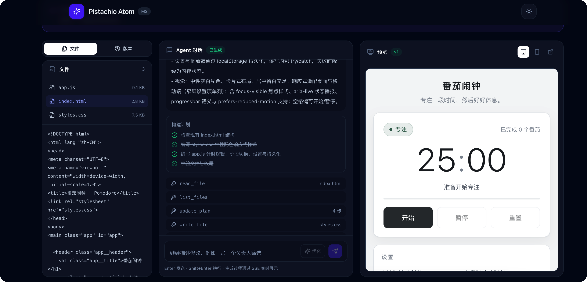
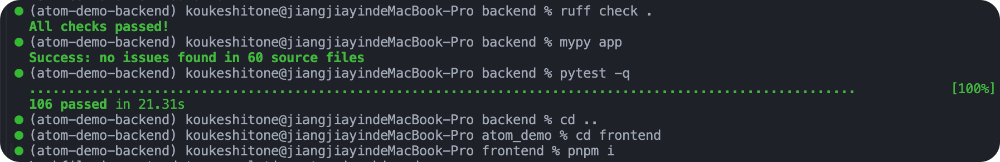
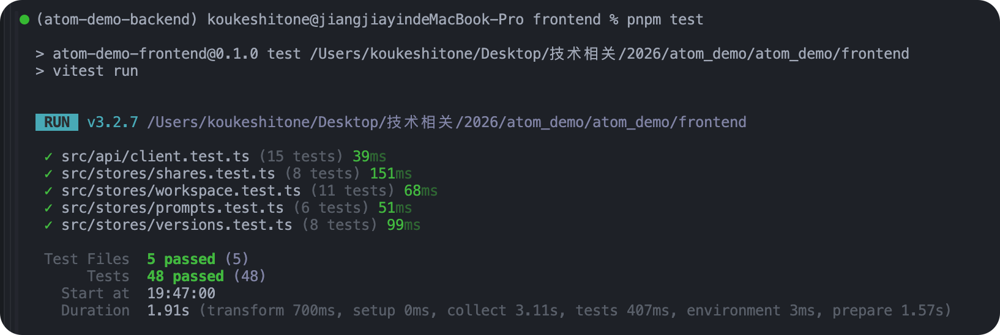
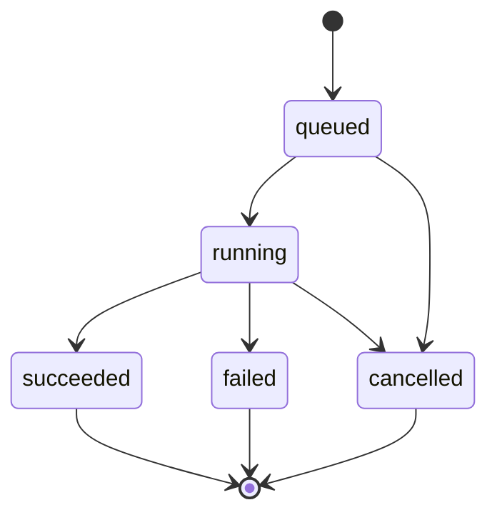
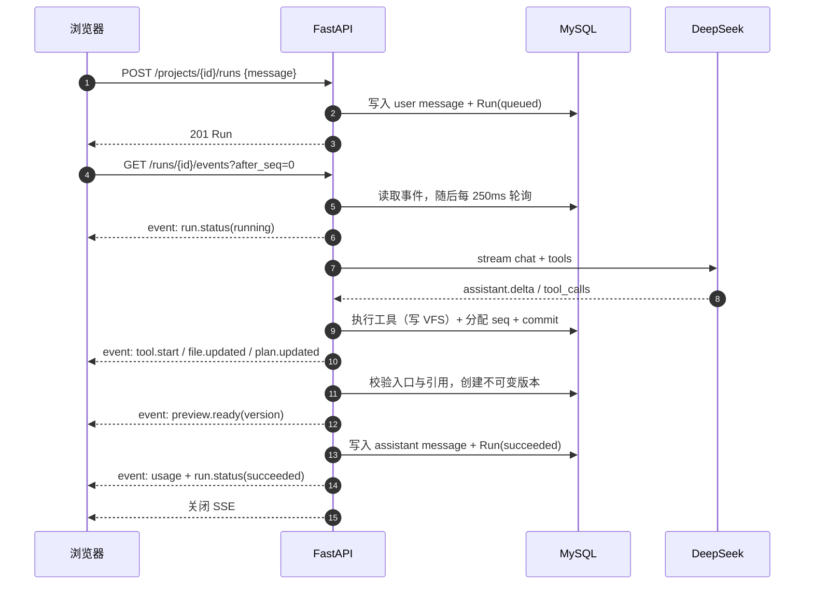
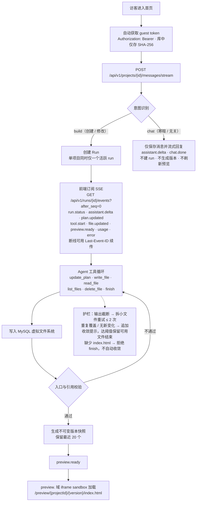
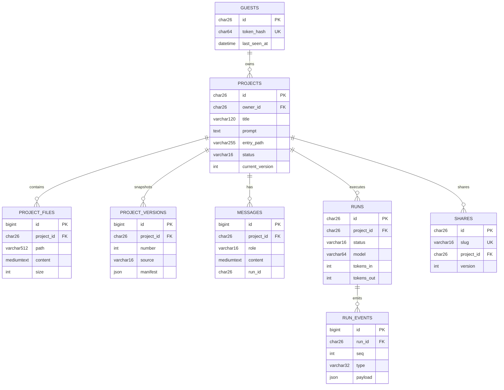
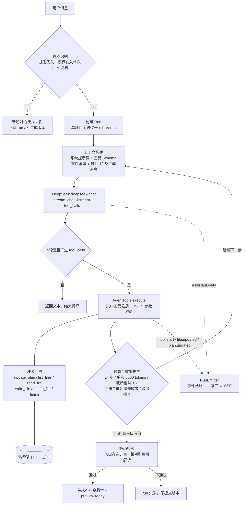

# Pistachio Atom 交付说明

| 项目 | 内容 |
|---|---|
| 线上地址 | https://atom.pistachio.asia |
| 文档日期 | 2026-11-08 |
| 详情见 | [需求文档](./01-需求文档.md)、[技术方案](./02-技术方案.md)、[功能清单](./03-功能清单.md)、[README](./../README.md) |

---

## Agent 对话效果


## 质量检查通过率

后端：



前端：



## 1. 实现思路｜详情见：[需求文档](./01-需求文档.md)、[技术方案](./02-技术方案.md)

一句话：**用户描述需求 → Agent 通过工具把文件写进 MySQL 虚拟文件系统（VFS）→ 校验后生成不可变版本 → 在独立预览域运行 → 可继续对话迭代、回滚、导出、分享**。

关键设计：

- **过程可观察**：计划、工具调用、文件变化、token 用量全部是真实事件，经 SSE 实时推送，不伪造进度。
- **工具化写入**：Agent 只能调用 `update_plan / write_file / read_file / list_files / delete_file / finish`，不能直接写服务器文件系统；路径、扩展名、大小、步数均有服务端校验。
- **MySQL 单一事实源**：项目、文件、消息、run、事件、版本、分享全部落库；不引入 Redis、消息队列、对象存储，降低运维面。
- **事件先落库再推送**：每个 SSE 事件分配单调 `seq` 后入库，再推送给前端，因此刷新或断线可用 `Last-Event-ID` 回放。
- **生成代码绝不执行**：服务端只存文本；预览跑在独立 `preview.` 域 iframe sandbox 中，配合 Host 校验与 CSP，禁止预览域调用业务 API。
- **匿名可用**：guest token 存 localStorage，服务端只存 SHA-256；所有接口走 `Authorization: Bearer`，不用 Cookie。

## 2. 关键取舍

| 决策 | 放弃的东西 | 换来的收益 |
|---|---|---|
| 文件与版本存 MySQL | 大文件效率、Git 式增量存储 | 事务一致、单事实源、部署简单；文件上限 32KB/256KB 使规模可控 |
| 版本用全量 JSON 快照 | 存储冗余 | 不可变语义简单可靠，diff 可随时由快照计算；版本上限 20 |
| 单项目同时一个 run | 并发吞吐 | 避免同项目文件并发写冲突，前端状态无需合并 |
| 全局并发 2 个 run | 吞吐 | 保护演示服务器与模型成本 |
| SSE 0.25s 轮询数据库 | 最多 250ms 延迟 | 不引入消息总线，事件量小，成本可接受 |
| 在线编辑推迟 | 直接编辑体验 | 编辑器、保存冲突、版本语义成本高；对话迭代已覆盖主路径 |

### 为什么采用单 Agent

| 维度       | 原因                                                         |
| ---------- | ------------------------------------------------------------ |
| 产物规模   | MVP 产物是 ≤256KB 的多文件静态 Web 应用，单上下文足以容纳，拆角色带来的收益有限 |
| 并发一致性 | 单项目同一时间只有一个 run，单 Agent 是唯一写者，天然避免多 Agent 并发写 VFS 的冲突与合并语义 |
| 控制面简单 | 步数预算、取消检查、截断重试、停滞收敛、入口强校验集中在一个循环里，阈值和状态转移可单测、可预测 |
| 契约简单   | 只有一条线性事件流，`seq` 单调递增，SSE 断线续传与前端展示无需跨 Agent 归并 |
| 成本与延迟 | 无 handoff 往返、无重复上下文装载，DeepSeek 单次工具循环的调用次数和延迟可控 |
| 安全边界   | 工具注册表是唯一写入出口，路径 / 扩展名 / 大小 / 不执行生成代码等红线集中在一处校验 |
| 可观测性   | 单轨迹便于把计划、工具、文件 diff、token 用量按时间顺序照实呈现，故障定位直接 |

PS: 后续随着项目的复杂度上升，会阶段化多 Agent，作为 P2 优先级（增长与平台化）处理。


---

## 3. 当前完成程度

### 3.1 已完成｜详情见：[功能清单](./03-功能清单.md)

> 核心闭环（创建 → 生成 → 预览 → 迭代 → 版本 → 导出 → 分享）已完整可用并通过质量门禁；当前主要短板是**公网防护（配额/限流/超时）**与**可观测和自动化（metrics/E2E/CI）**，这两组能力已在 P0/P1 中给出明确的补齐顺序。

- 规则优先的意图识别（build / chat）+ 模糊输入 LLM 复核；普通聊天流式回复且不污染生成上下文。
- 多轮对话记忆，可增量修改已实现的应用。
- LLM 优化用户提示词。
- 版本列表 / diff / 回滚为新版本 / ZIP 导出。
- 只读分享：7 / 30 天 / 永久、撤销、标准分享页与纯净应用页。
- SSE 实时事件、断线续传、隔离预览域、版本化预览 URL。
- DeepSeek Agent 循环：多文件生成、VFS 工具、预算与收敛护栏、入口强校验、取消。
- 匿名 guest、项目创建 / 列表 / 详情 / 删除、工作台三栏布局。
- Docker Compose + Caddy 双域名部署，使用香港轻量服务器部署。

### 3.2 未完成（后续版本迭代）

| 项目 | 状态 | 影响 |
|---|---|---|
| IP / 网关级限流 | 未实现 | 仅进程内 `Semaphore(2)`，公网可被脚本刷 |
| run 墙上时间上限 | 未实现 | 仅步数与 token 预算，长尾请求可能长时间占并发槽 |
| 在线代码编辑 | 未实现 | 文件面板只读，只能通过对话修改 |
| Markdown 渲染 | 未实现 | 聊天为纯文本，未接 markdown-it + DOMPurify |
| 项目分页 / 搜索 | 未实现 | 后端默认 50、最大 100；超出项目静默不可见 |
| 任意两版本对比 | 未实现 | 前端只支持相邻版本对比 |
| metrics / 告警 | 未实现 | 仅 structlog 日志，故障与成本不可见 |
| E2E / CI | 未实现 | 无 Playwright 冒烟，无自动化流水线 |


---

## 4. 继续投入的扩展计划与优先级

排序原则：**先补公网安全与稳定性风险，再补核心体验缺口，最后做增长型能力**。优先选「配置已存在、实现成本低、风险收益高」的项。

### P0（1–2 天量级，首先做）

1. **run 墙上时间上限**：总时长上限（如 5 分钟）+ 检查点取消，避免长尾占满并发槽。
2. **最小可观测集**：run 成功/失败计数、P50/P95 耗时、token 汇总、失败码分布。
3. **Markdown 安全渲染**：markdown-it + DOMPurify，限制链接与外链属性。

### P1（体验与质量）

1. 支持多模态输入：视觉稿图片输入、语音输入。
2. 优化多轮对话记忆技术方案。
3. 在线代码编辑：CodeMirror 6 + 显式保存生成新版本，需定义保存冲突与白名单。
4. 生成质量回归集：固定 10–20 条 prompt，断言入口、文件数与关键交互，作为提示词改动门禁。
5. 项目 / 版本列表的分页与搜索。
6. Playwright E2E 冒烟 + GitHub Actions，把现有门禁自动化。

### P2（增长与平台化）

1. Redis 限流、缓存。
2. 生成应用一键部署 / 自定义域名。
3. 模板与配方库（看板、打卡、作品集、落地页）。
4. 账号体系与跨设备同步（会改变匿名模型，需重新评估数据与权限）。
5. 支持导入/上传本地已有项目进行二次开发。
6. 阶段化多 Agent，优先实现：
   - 固定流水线 Planner → Generator → Reviewer，共享同一 VFS 与工具注册表；Reviewer 只读，handoff 限制 1–2 次。
   - 收益：提升复杂项目与生成质量，评审职责独立。
   - 前置条件和风险：需定义 handoff 契约与事件映射；延迟与 token 成本上升。
7. 支持生成复杂的工程化项目（比如Vite构建Vue）。
8. 多语言。

---


## 附录

### 1. 架构总览

```
                          ┌──────────────────────────────┐
                          │          浏览器               │
                          │  Vue 3 SPA（主站域）          │
                          └──────────────┬───────────────┘
                                         │ HTTPS
                          ┌──────────────▼───────────────┐
                          │            Caddy             │
                          │  app.──► web(nginx SPA)      │
                          │       └► api /api/* /healthz │
                          │  preview.──► api /preview/*  │
                          │            /share-preview/*  │
                          └───────┬──────────────┬───────┘
                                  │              │
                     ┌────────────▼───┐   ┌──────▼─────────────────┐
                     │ nginx 静态资源 │   │ FastAPI API            │
                     │ Vue 构建产物   │   │ routes → services → db │
                     └────────────────┘   │        └► agent        │
                                          │             └► LLM GW  │
                                          └──────┬─────────────────┘
                                                 │ asyncmy
                                          ┌──────▼──────┐
                                          │  MySQL 8    │
                                          │ 唯一事实源  │
                                          └─────────────┘
```

- **主站域**：页面、业务 API、SSE。
- **预览域**：只提供生成应用的静态文件（`/preview`）与分享预览（`/share-preview`），不暴露业务 API。
- **MySQL**：项目、文件、版本、消息、run、事件、分享全部落库；无 Redis、消息队列、对象存储。
- **LLM**：仅在 API 进程内经 `LLMGateway` 调用 DeepSeek；前端不持有 Key，不直连模型。


### 2. Run 状态机



- 单项目同时只允许一个 `queued` / `running` run，重复发起返回 `409`。
- 取消不提交版本；失败通过 `error` + `run.status(failed)` 通知前端。


### 3. 一次生成的时序示意




### 4. 生成流程



项目标题在创建时由后端根据描述生成（6–20 字，保留品牌/行业关键词），不再直接截取描述原文；演示模式、标题模型失败或超时（8s）时回退到模板分类标题（团队任务看板 / 习惯打卡 / 个人作品集 / 创意原型），不影响项目创建。显式传入 `title` 时不做模型调用。


### 5. ER 示意图



等价关系速览：

```text
guests 1 ── N projects
projects 1 ── N project_files
projects 1 ── N project_versions
projects 1 ── N messages
projects 1 ── N runs 1 ── N run_events
projects 1 ── N shares
```


### 6. 数据模型

| 表 | 关键字段 | 说明 |
|---|---|---|
| `guests` | `id`(ULID), `token_hash`(SHA-256), `last_seen_at` | 匿名身份；token 明文不落库 |
| `projects` | `id`, `owner_id`, `title`, `prompt`, `entry_path`, `status`, `current_version` | 项目主记录；索引 `(owner_id, updated_at)` |
| `project_files` | `project_id`, `path`, `content`(MEDIUMTEXT), `size` | 当前 VFS；唯一约束 `(project_id, path)` |
| `project_versions` | `project_id`, `number`, `label`, `source`, `manifest`(JSON) | 不可变快照；唯一 `(project_id, number)` |
| `messages` | `project_id`, `role`, `content`, `run_id` | `run_id` 空 = 普通聊天，非空 = 生成上下文；索引 `(project_id, id)` |
| `runs` | `id`, `project_id`, `status`, `model`, `tokens_in/out`, `error_*`, 时间戳 | 一次生成任务 |
| `run_events` | `run_id`, `seq`, `type`, `payload`(JSON) | 事件流；唯一 `(run_id, seq)` |
| `shares` | `id`, `slug`(唯一), `project_id`, `version`, `expires_at`, `revoked` | 只读分享 |

约定：所有表结构经 Alembic 管理；时间以 UTC 存储；项目 ID 使用 ULID；不返回 ORM 模型，统一 Pydantic Schema。


### 7. Agent 系统原理

#### 7.1 当前是单 Agent

当前实现是 **单 Agent + 工具调用循环**：一个 DeepSeek 模型、一个编排循环（`agent/orchestrator.py::_run_agent`）、一份集中式工具注册表（`agent/tools.py`）。没有 Planner / Coder / Reviewer 等角色拆分，也没有 Agent 之间的委派与消息传递。

- 只有一份系统提示词（`agent/prompts.py::build_system_prompt`），不存在按角色切换的 Agent 定义。
- 工具表固定为 6 个（`update_plan / list_files / read_file / write_file / delete_file / finish`），没有 `delegate` / `handoff` 这类跨 Agent 工具。
- 所有工具调用都在同一个会话上下文内**串行**执行，由单个编排器负责状态与事务，不存在 Agent 间通信通道。
- `update_plan` 只是给前端展示的 UI 计划，不是独立的规划 Agent。
- 意图识别、项目标题生成、提示词优化是**一次性 LLM 调用**。



补充说明：

- **所有写入走工具**：Agent 只能通过 `write_file` 等工具修改 MySQL 中的 VFS；路径、扩展名、单文件 32KB / 单工程 256KB 上限在工具层集中校验。
- **LLM 不可用时**：`_run_demo` 套用内置模板，但仍走同一套工具、事件、校验与版本流程，并在事件与界面中标注演示模式。
- **模型出口唯一**：所有模型调用经 `LLMGateway`，前端不持有 Key；Provider 抽象允许切换兼容服务。

