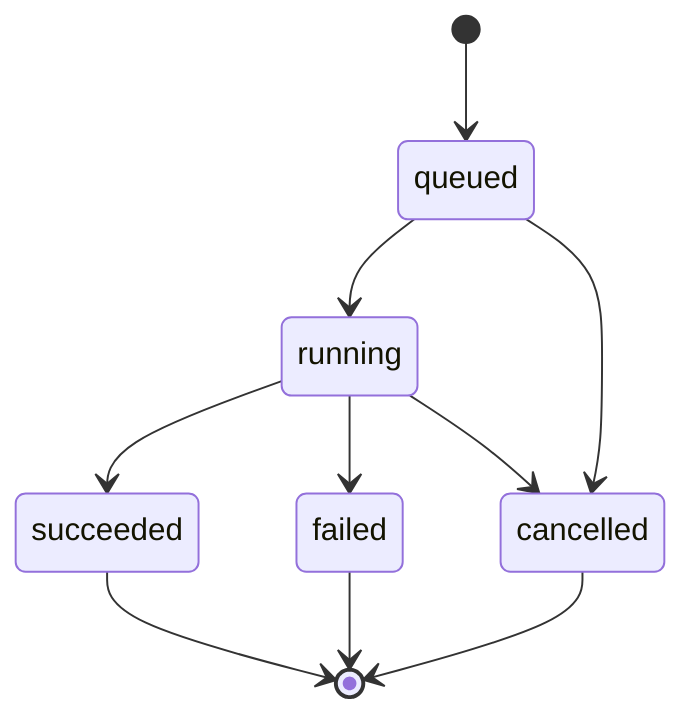
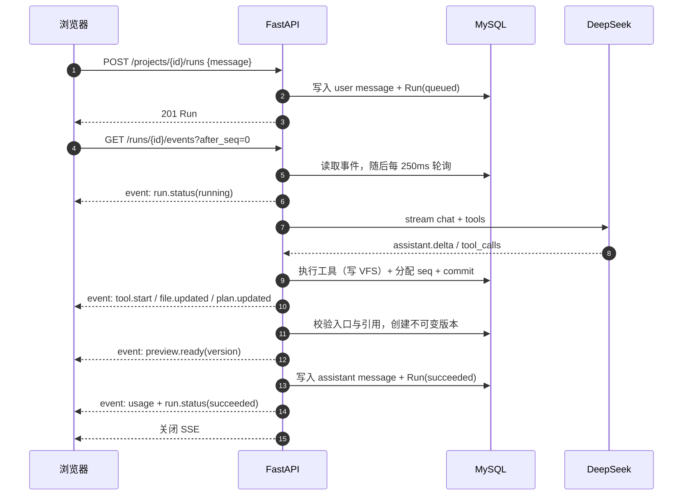
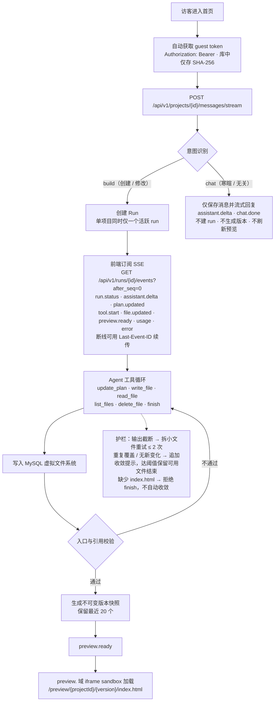
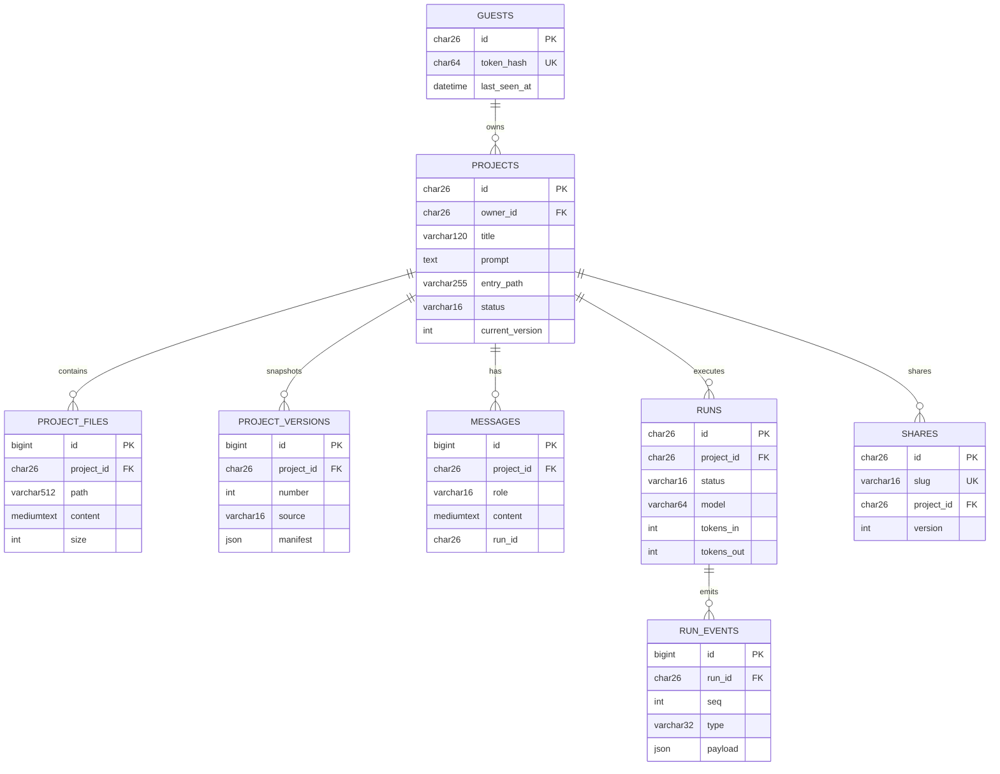

# Pistachio Atom 交付说明

| 项目 | 内容 |
|---|---|
| 线上地址 | https://atom.pistachio.asia |
| 文档日期 | 2026-11-08 |
| 依据 | [需求文档](./01-需求文档.md)、[技术方案](./02-技术方案.md)、[功能清单](./03-功能清单.md) |

---

## 1. 实现思路

一句话：**用户描述需求 → Agent 通过工具把文件写进 MySQL 虚拟文件系统（VFS）→ 校验后生成不可变版本 → 在独立预览域运行 → 可继续对话迭代、回滚、导出、分享**。

关键设计：

- **过程可观察**：计划、工具调用、文件变化、token 用量全部是真实事件，经 SSE 实时推送，不伪造进度。
- **工具化写入**：Agent 只能调用 `update_plan / write_file / read_file / list_files / delete_file / finish`，不能直接写服务器文件系统；路径、扩展名、大小、步数均有服务端校验。
- **MySQL 单一事实源**：项目、文件、消息、run、事件、版本、分享全部落库；不引入 Redis、消息队列、对象存储，降低运维面。
- **事件先落库再推送**：每个 SSE 事件分配单调 `seq` 后入库，再推送给前端，因此刷新或断线可用 `Last-Event-ID` 回放。
- **生成代码绝不执行**：服务端只存文本；预览跑在独立 `preview.` 域 iframe sandbox 中，配合 Host 校验与 CSP，禁止预览域调用业务 API。
- **匿名可用**：guest token 存 localStorage，服务端只存 SHA-256；所有接口走 `Authorization: Bearer`，不用 Cookie。

### 关键取舍

| 决策 | 放弃的东西 | 换来的收益 |
|---|---|---|
| 文件与版本存 MySQL | 大文件效率、Git 式增量存储 | 事务一致、单事实源、部署简单；文件上限 32KB/256KB 使规模可控 |
| 版本用全量 JSON 快照 | 存储冗余 | 不可变语义简单可靠，diff 可随时由快照计算；版本上限 20 |
| 单项目同时一个 run | 并发吞吐 | 避免同项目文件并发写冲突，前端状态无需合并 |
| 全局并发 2 个 run | 吞吐 | 保护演示服务器与模型成本 |
| SSE 0.25s 轮询数据库 | 最多 250ms 延迟 | 不引入消息总线，事件量小，成本可接受 |
| 在线编辑推迟 | 直接编辑体验 | 编辑器、保存冲突、版本语义成本高；对话迭代已覆盖主路径 |
| 演示模式 | 无 Key 时能力受限 | 保证 Demo 可完整跑通，并在界面与事件中明确标注，不伪造输出 |

---

## 2. 当前完成程度

功能清单共 115 项：**已完成 99（86.1%）、部分完成 2、未实现 13、不在范围 1**。质量门禁：后端 **106** 个测试、前端 **48** 个测试通过，ruff / mypy / lint / typecheck / build 均通过。

### 2.1 已完成

- 匿名 guest、项目创建 / 列表 / 详情 / 删除、工作台三栏布局。
- 规则优先的意图识别（build / chat）+ 模糊输入 LLM 复核；普通聊天流式回复且不污染生成上下文。
- DeepSeek Agent 循环：多文件生成、VFS 工具、预算与收敛护栏、入口强校验、取消。
- SSE 实时事件、断线续传、隔离预览域、版本化预览 URL。
- 多轮对话记忆，可增量修改已实现的应用。
- 版本列表 / diff / 回滚为新版本 / ZIP 导出。
- 只读分享：7 / 30 天 / 永久、撤销、标准分享页与纯净应用页。
- 用户提示词优化，提示词优化弹窗
- Docker Compose + Caddy 双域名部署。

### 2.2 未完成 / 部分完成

| 项目 | 状态 | 影响 |
|---|---|---|
| 每日 guest 生成配额 | 未强制 | `MAX_RUNS_PER_GUEST_DAY` 仅有配置，代码未消费 |
| IP / 网关级限流 | 未实现 | 仅进程内 `Semaphore(2)`，公网可被脚本刷 |
| run 墙上时间上限 | 未实现 | 仅步数与 token 预算，长尾请求可能长时间占并发槽 |
| 在线代码编辑 | 未实现 | 文件面板只读，只能通过对话修改 |
| 重命名 UI | 部分 | 后端 PATCH 与 store 已就绪，界面还没实现入口 |
| Markdown 渲染 | 未实现 | 聊天为纯文本，未接 markdown-it + DOMPurify |
| 移动端 Tab 布局 | 未实现 | 小屏为纵向堆叠，可用但非最优 |
| 项目分页 / 搜索 | 未实现 | 后端默认 50、最大 100；超出项目静默不可见 |
| 任意两版本对比 | 未实现 | 前端只支持相邻版本对比 |
| 分享访问统计 | 未实现 | 无计数、来源分析、二维码 |
| metrics / 告警 | 未实现 | 仅 structlog 日志，故障与成本不可见 |
| E2E / CI | 未实现 | 无 Playwright 冒烟，无自动化流水线 |
| 401 自愈 | 部分 | 仅项目列表实现「清 token → 重新 bootstrap → 重试一次」 |

不在本期范围：注册登录 / 团队协作 / 支付、一键部署生成应用到第三方、Redis / MQ / 对象存储、WebSocket、服务端执行生成代码或 SSR。

---

## 3. 继续投入的扩展计划与优先级

排序原则：**先补公网安全与稳定性风险，再补核心体验缺口，最后做增长型能力**。优先选「配置已存在、实现成本低、风险收益高」的项。

### P0（1–2 天量级，首先做）

1. **强制每日 guest 配额**：创建 run 前按 guest + UTC 日计数，超限返回 429；配置已存在。
2. **IP / guest 限流**：至少覆盖 bootstrap、消息流、创建 run；可先在进程内做固定窗口。
3. **run 墙上时间上限**：总时长上限（如 5 分钟）+ 检查点取消，避免长尾占满并发槽。
4. **最小可观测集**：run 成功/失败计数、P50/P95 耗时、token 汇总、失败码分布。
5. **重命名 UI**：后端与 store 已就绪，补行内编辑即可。
6. **Markdown 安全渲染**：markdown-it + DOMPurify，限制链接与外链属性。
7. **支持复杂项目生成**：支持生成Vue3项目。

### P1（体验与质量）

1. 在线代码编辑：CodeMirror 6 + 显式保存生成新版本，需定义保存冲突与白名单。
2. 移动端三 Tab（对话 / 预览 / 文件）。
3. 生成质量回归集：固定 10–20 条 prompt，断言入口、文件数与关键交互，作为提示词改动门禁。
4. 项目 / 版本列表的分页与搜索。
5. Playwright E2E 冒烟 + GitHub Actions，把现有门禁自动化。

### P2（增长与平台化）

1. 分享访问统计、二维码、自定义封面。
2. 生成应用一键部署 / 自定义域名。
3. 模板与配方库（看板、打卡、作品集、落地页）。
4. 账号体系与跨设备同步（会改变匿名模型，需重新评估数据与权限）。
5. 支持导入/上传本地已有项目进行编辑。

---

## 4. 一句话结论

核心闭环（创建 → 生成 → 预览 → 迭代 → 版本 → 导出 → 分享）已完整可用并通过质量门禁；当前主要短板是**公网防护（配额/限流/超时）**与**可观测和自动化（metrics/E2E/CI）**，这两组能力已在 P0/P1 中给出明确的补齐顺序。


## 附录

### 1. 架构总览

```
                          ┌──────────────────────────────┐
                          │          浏览器               │
                          │  Vue 3 SPA（主站域）          │
                          └──────────────┬───────────────┘
                                         │ HTTPS
                          ┌──────────────▼───────────────┐
                          │            Caddy             │
                          │  app.──► web(nginx SPA)      │
                          │       └► api /api/* /healthz │
                          │  preview.──► api /preview/*  │
                          │            /share-preview/*  │
                          └───────┬──────────────┬───────┘
                                  │              │
                     ┌────────────▼───┐   ┌──────▼─────────────────┐
                     │ nginx 静态资源 │   │ FastAPI API            │
                     │ Vue 构建产物   │   │ routes → services → db │
                     └────────────────┘   │        └► agent        │
                                          │             └► LLM GW  │
                                          └──────┬─────────────────┘
                                                 │ asyncmy
                                          ┌──────▼──────┐
                                          │  MySQL 8    │
                                          │ 唯一事实源  │
                                          └─────────────┘
```

- **主站域**：页面、业务 API、SSE。
- **预览域**：只提供生成应用的静态文件（`/preview`）与分享预览（`/share-preview`），不暴露业务 API。
- **MySQL**：项目、文件、版本、消息、run、事件、分享全部落库；无 Redis、消息队列、对象存储。
- **LLM**：仅在 API 进程内经 `LLMGateway` 调用 DeepSeek；前端不持有 Key，不直连模型。


### 2. Run 状态机



- 单项目同时只允许一个 `queued` / `running` run，重复发起返回 `409`。
- 取消不提交版本；失败通过 `error` + `run.status(failed)` 通知前端。


### 3. 一次生成的时序示意




### 4. 生成流程



项目标题在创建时由后端根据描述生成（6–20 字，保留品牌/行业关键词），不再直接截取描述原文；演示模式、标题模型失败或超时（8s）时回退到模板分类标题（团队任务看板 / 习惯打卡 / 个人作品集 / 创意原型），不影响项目创建。显式传入 `title` 时不做模型调用。


### 5. ER 示意图



等价关系速览：

```text
guests 1 ── N projects
projects 1 ── N project_files
projects 1 ── N project_versions
projects 1 ── N messages
projects 1 ── N runs 1 ── N run_events
projects 1 ── N shares
```


### 6. 数据模型

| 表 | 关键字段 | 说明 |
|---|---|---|
| `guests` | `id`(ULID), `token_hash`(SHA-256), `last_seen_at` | 匿名身份；token 明文不落库 |
| `projects` | `id`, `owner_id`, `title`, `prompt`, `entry_path`, `status`, `current_version` | 项目主记录；索引 `(owner_id, updated_at)` |
| `project_files` | `project_id`, `path`, `content`(MEDIUMTEXT), `size` | 当前 VFS；唯一约束 `(project_id, path)` |
| `project_versions` | `project_id`, `number`, `label`, `source`, `manifest`(JSON) | 不可变快照；唯一 `(project_id, number)` |
| `messages` | `project_id`, `role`, `content`, `run_id` | `run_id` 空 = 普通聊天，非空 = 生成上下文；索引 `(project_id, id)` |
| `runs` | `id`, `project_id`, `status`, `model`, `tokens_in/out`, `error_*`, 时间戳 | 一次生成任务 |
| `run_events` | `run_id`, `seq`, `type`, `payload`(JSON) | 事件流；唯一 `(run_id, seq)` |
| `shares` | `id`, `slug`(唯一), `project_id`, `version`, `expires_at`, `revoked` | 只读分享 |

约定：所有表结构经 Alembic 管理；时间以 UTC 存储；项目 ID 使用 ULID；不返回 ORM 模型，统一 Pydantic Schema。
